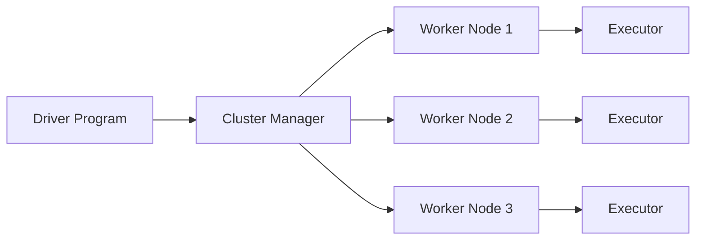

# What is Apache Spark?

## What You'll Learn
- What Apache Spark is and why it was created
- The difference between Spark and traditional data tools
- When Spark is the right choice for your project
- Key concepts: distributed computing, in-memory processing

## The Big Picture

Apache Spark is an **open-source, distributed computing engine** designed to process large datasets across a cluster of machines. Think of it as a supercharged data processing engine that can handle terabytes (or even petabytes) of data.

Before Spark, the go-to tool for big data was **MapReduce** (part of Hadoop). MapReduce worked, but it was painfully slow because it wrote intermediate results to disk after every step.

Spark changed the game by keeping data **in memory** between processing steps — making it up to **100x faster** than MapReduce for certain workloads.

## Your First Taste of PySpark

Here's a simple example that reads a CSV file and counts rows:

```python
from pyspark.sql import SparkSession

# Create a Spark session
spark = SparkSession.builder \
    .appName("MyFirstApp") \
    .getOrCreate()

# Read a CSV file into a DataFrame
df = spark.read.csv("sales_data.csv", header=True, inferSchema=True)

# Count the rows
print(f"Total rows: {df.count()}")

# Show the first 5 rows
df.show(5)
```

### Expected Output
```
Total rows: 1000000
+----------+--------+-------+
|      date|product |revenue|
+----------+--------+-------+
|2024-01-01| Widget |  29.99|
|2024-01-01| Gadget |  49.99|
|2024-01-02| Widget |  29.99|
|2024-01-02| Gizmo  |  19.99|
|2024-01-03| Gadget |  49.99|
+----------+--------+-------+
only showing top 5 rows
```

## When to Use Spark

Spark shines when you need to:

1. **Process datasets that don't fit in memory** on a single machine
2. **Run complex analytics** (aggregations, joins, ML pipelines) on large data
3. **Build ETL pipelines** that transform data from multiple sources
4. **Stream real-time data** from Kafka, Kinesis, or other sources

If your data fits comfortably in a Pandas DataFrame (under ~10GB), you probably don't need Spark yet. We'll cover this comparison in detail in the next lesson.

## How Spark Works (Simplified)



The **Driver** is your main program. It sends tasks to **Executors** running on **Worker Nodes** across the cluster. The Cluster Manager (like YARN or Kubernetes) coordinates everything.

## Installing Spark Locally

For now, all you need is Python and pip:

```bash
pip install pyspark
```

That's it. PySpark bundles a local Spark instance — no cluster needed for learning.

## Common Mistakes

- **Trying to learn Spark before Python.** Spark's API is Python-based. If you're not comfortable with Python basics (lists, dicts, functions), learn those first.
- **Using Spark for small datasets.** Spark has startup overhead. For datasets under 1GB, Pandas is faster and simpler. Match the tool to the task.
- **Ignoring the Spark UI.** The web UI at `localhost:4040` shows exactly what Spark is doing. Always check it when things are slow.

## Key Takeaways
- Spark is a distributed computing engine for big data
- It's up to 100x faster than MapReduce thanks to in-memory processing
- PySpark lets you use Spark with Python
- You don't need a cluster to learn — `pip install pyspark` is enough
- Don't use Spark for small data — Pandas is better for that

## Next Lesson
In the next lesson, we'll compare Spark and Pandas side-by-side to help you decide when to use each tool.
