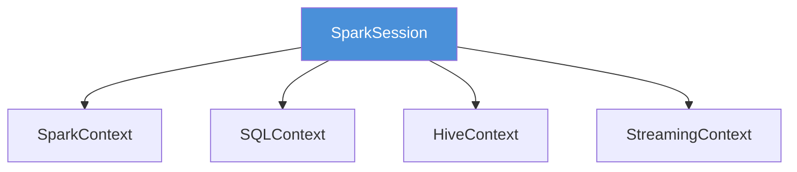

# Your First SparkSession

## What You'll Learn
- What a SparkSession is and why it matters
- How to create and configure a SparkSession
- The SparkSession lifecycle (create → use → stop)
- Key configuration options for development
- How to avoid common SparkSession pitfalls

## What is a SparkSession?

The SparkSession is your **entry point to all Spark functionality**. Every PySpark program starts by creating one. Think of it as opening a connection to the Spark engine.

Before Spark 2.0, you had to create separate contexts (SparkContext, SQLContext, HiveContext). Now, SparkSession unifies all of these into a single object.



## Creating a SparkSession

The simplest way:

```python
from pyspark.sql import SparkSession

spark = SparkSession.builder \
    .appName("MyFirstApp") \
    .getOrCreate()

print(f"Spark version: {spark.version}")
print(f"App name: {spark.sparkContext.appName}")
```

### Expected Output
```
Spark version: 3.5.0
App name: MyFirstApp
```

## The Builder Pattern

SparkSession uses the **builder pattern** — you chain configuration calls before creating the session:

```python
spark = SparkSession.builder \
    .appName("ConfiguredApp") \
    .master("local[*]") \
    .config("spark.sql.shuffle.partitions", "4") \
    .config("spark.driver.memory", "2g") \
    .config("spark.ui.showConsoleProgress", "false") \
    .getOrCreate()
```

### Key Configuration Options

| Config | What it does | Good default |
|--------|-------------|--------------|
| `appName` | Names your app (shows in Spark UI) | Always set this |
| `master` | Where to run: `local[*]`, `yarn`, `k8s` | `local[*]` for dev |
| `spark.driver.memory` | Memory for the driver | `2g` for dev |
| `spark.sql.shuffle.partitions` | Partitions during shuffles | `4` for dev, `200` for prod |
| `spark.ui.showConsoleProgress` | Show progress bars | `false` to reduce noise |

## The `master` Setting

The `master` URL tells Spark where to run:

```python
# Use all available CPU cores locally
.master("local[*]")

# Use exactly 4 cores
.master("local[4]")

# Single thread (useful for debugging)
.master("local[1]")

# Connect to a YARN cluster
.master("yarn")
```

For learning, always use `local[*]`.

## getOrCreate() vs New Session

`getOrCreate()` is smart — it returns the **existing session** if one is already running, or creates a new one:

```python
# First call: creates a new session
spark1 = SparkSession.builder.appName("App1").getOrCreate()

# Second call: returns the SAME session (ignores new appName)
spark2 = SparkSession.builder.appName("App2").getOrCreate()

print(spark1 is spark2)  # True!
```

### Expected Output
```
True
```

If you need a truly new session, use `newSession()`:

```python
spark_new = spark1.newSession()
```

## Stopping a SparkSession

Always stop your session when done:

```python
spark.stop()
```

This releases resources (memory, ports, threads). In a script, put it at the end. In a notebook, stop it when you're done experimenting.

## A Complete Example

Here's a full program that creates a session, does some work, and cleans up:

```python
from pyspark.sql import SparkSession

# 1. Create the session
spark = SparkSession.builder \
    .appName("EmployeeAnalysis") \
    .master("local[*]") \
    .config("spark.sql.shuffle.partitions", "4") \
    .getOrCreate()

# 2. Create sample data
employees = [
    ("Alice", "Engineering", 95000),
    ("Bob", "Engineering", 110000),
    ("Charlie", "Marketing", 85000),
    ("Diana", "Marketing", 92000),
    ("Eve", "Engineering", 105000),
]

df = spark.createDataFrame(employees, ["name", "department", "salary"])

# 3. Analyze
print("All employees:")
df.show()

print("Average salary by department:")
df.groupBy("department").avg("salary").show()

# 4. Clean up
spark.stop()
```

### Expected Output
```
All employees:
+-------+-----------+------+
|   name| department|salary|
+-------+-----------+------+
|  Alice|Engineering| 95000|
|    Bob|Engineering|110000|
|Charlie|  Marketing| 85000|
|  Diana|  Marketing| 92000|
|    Eve|Engineering|105000|
+-------+-----------+------+

Average salary by department:
+-----------+-----------+
| department|avg(salary)|
+-----------+-----------+
|Engineering|   103333.3|
|  Marketing|    88500.0|
+-----------+-----------+
```

## Common Mistakes

- **Not calling `spark.stop()`.** This leaves Spark processes running in the background, consuming memory and ports. Always stop when done.
- **Setting master in production code.** The cluster manager should set the master, not your code. Only use `.master("local[*]")` during development. In production, submit with `spark-submit --master yarn`.
- **Creating multiple SparkSessions.** Each session consumes resources. Use `getOrCreate()` to avoid duplicates.

## Key Takeaways
- SparkSession is the single entry point to all Spark functionality
- Use the builder pattern to configure before creating
- `getOrCreate()` reuses existing sessions
- Always set `appName` for identification in the Spark UI
- Use `local[*]` as master during development
- Always call `spark.stop()` when finished

## Next Lesson
Your SparkSession automatically starts a web UI at `localhost:4040`. Next, we'll explore how to use it to monitor and debug your Spark applications.
