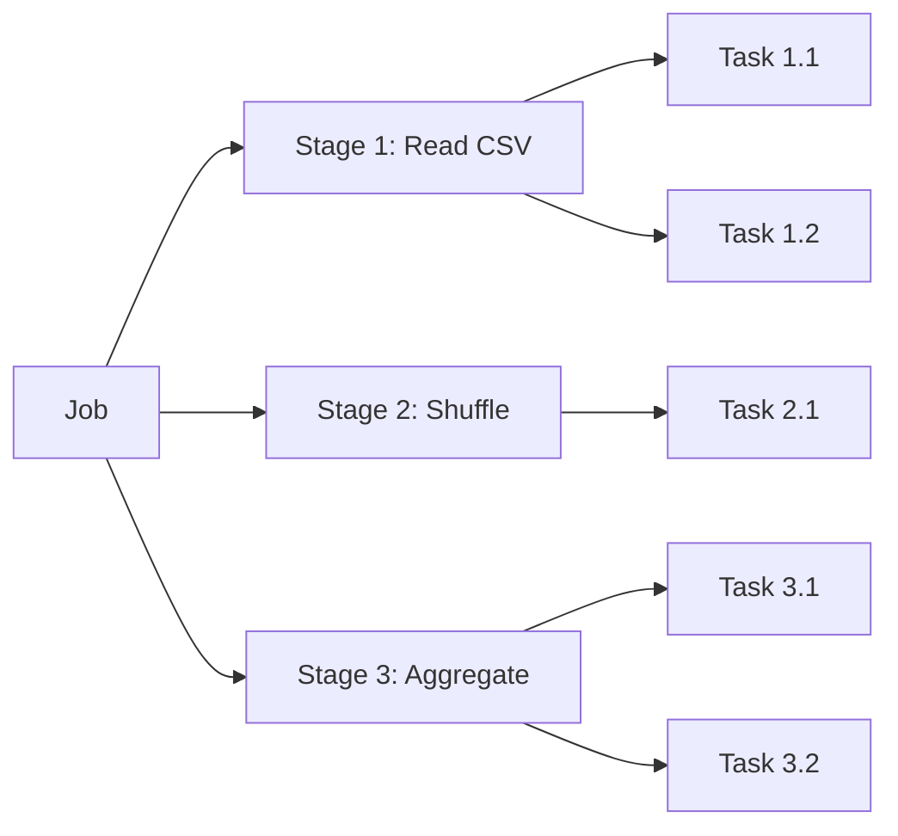

# Understanding the Spark UI

## What You'll Learn
- How to access and navigate the Spark Web UI
- What jobs, stages, and tasks mean in Spark
- How to identify performance bottlenecks
- How to read the DAG visualization
- Key metrics to monitor during execution

## Accessing the Spark UI

When you create a SparkSession, Spark automatically starts a web server:

```python
from pyspark.sql import SparkSession

spark = SparkSession.builder \
    .appName("UIDemo") \
    .master("local[*]") \
    .getOrCreate()

print(f"Spark UI: http://localhost:{spark.sparkContext.uiWebUrl.split(':')[-1]}")
```

By default, it runs at **http://localhost:4040**. If that port is taken, Spark tries 4041, 4042, and so on.

## The Main Tabs

The Spark UI has several tabs. Here are the most important ones:

### Jobs Tab
Shows all jobs triggered by actions (`.show()`, `.count()`, `.write()`). Each job has:
- **Status**: Running, Succeeded, or Failed
- **Duration**: Total execution time
- **Stages**: How many stages the job was split into

### Stages Tab
Each job is split into stages at **shuffle boundaries**. A stage contains tasks that can run in parallel:



### Storage Tab
Shows cached/persisted DataFrames and their memory usage.

### SQL/DataFrame Tab
Shows the execution plans for SQL queries and DataFrame operations — essential for optimization.

## Jobs, Stages, and Tasks Explained

Understanding this hierarchy is crucial:

| Level | What It Is | Triggered By |
|-------|-----------|--------------|
| **Job** | A complete computation | An action (`.show()`, `.count()`, `.write()`) |
| **Stage** | A set of tasks with no shuffles between them | Shuffle boundaries (`.groupBy()`, `.join()`) |
| **Task** | Work done on one data partition | One task per partition per stage |

## Triggering a Job to Observe

Let's create some data and watch the UI:

```python
from pyspark.sql import SparkSession
from pyspark.sql.functions import col, avg, count

spark = SparkSession.builder \
    .appName("UIExplorer") \
    .master("local[*]") \
    .config("spark.sql.shuffle.partitions", "4") \
    .getOrCreate()

# Create sample data
data = [(f"user_{i}", f"product_{i % 5}", i * 10.0) for i in range(10000)]
df = spark.createDataFrame(data, ["user", "product", "amount"])

# This triggers Job 1 (read + filter)
expensive = df.filter(col("amount") > 50000)
print(f"Expensive purchases: {expensive.count()}")

# This triggers Job 2 (read + group + aggregate)
summary = df.groupBy("product").agg(
    avg("amount").alias("avg_amount"),
    count("*").alias("total")
)
summary.show()
```

### Expected Output
```
Expensive purchases: 4999

+---------+----------+-----+
|  product|avg_amount|total|
+---------+----------+-----+
|product_0|   49980.0| 2000|
|product_1|   49990.0| 2000|
|product_2|   50000.0| 2000|
|product_3|   50010.0| 2000|
|product_4|   50020.0| 2000|
+---------+----------+-----+
```

Now open **http://localhost:4040** and you'll see 2 completed jobs.

## Reading the DAG Visualization

Click on any job to see its **Directed Acyclic Graph (DAG)**. This shows the physical execution plan:

- **Green boxes**: Completed stages
- **Blue boxes**: Skipped stages (data was cached)
- **Arrows**: Data flow between stages

The DAG reveals where shuffles happen. Each shuffle boundary means data is being redistributed across partitions — an expensive operation.

## Key Metrics to Watch

### In the Stages tab, look for:

1. **Shuffle Read/Write Size**: Large shuffles slow things down
2. **Task Duration**: If some tasks are much slower than others, you have a **data skew** problem
3. **GC Time**: High garbage collection time means you need more memory
4. **Input Size**: Verify Spark is reading the expected amount of data

### Task Duration Distribution

The **Event Timeline** in the stage detail page shows task execution over time. Ideally, all tasks should finish around the same time. If one task takes 10x longer, that partition has more data than others.

## Using the SQL Tab

For DataFrame operations, the SQL tab is gold. It shows:
- The **logical plan** (what you asked for)
- The **physical plan** (how Spark will do it)
- **Metrics** per operator (rows processed, time spent)

```python
# Run a query to see in SQL tab
df.createOrReplaceTempView("purchases")
result = spark.sql("""
    SELECT product, AVG(amount) as avg_amount
    FROM purchases
    WHERE amount > 1000
    GROUP BY product
    ORDER BY avg_amount DESC
""")
result.show()
```

## Common Mistakes

- **Ignoring the Spark UI completely.** The UI tells you exactly where time is spent. If your job is slow, the answer is in the UI — not in guessing.
- **Not checking for data skew.** If one task takes 10 minutes and the rest take 10 seconds, one partition has most of the data. The Stages tab reveals this instantly.
- **Forgetting the UI disappears when SparkSession stops.** The UI is only available while Spark is running. For historical data, configure the Spark History Server.

## Key Takeaways
- The Spark UI runs at `localhost:4040` automatically
- Jobs → Stages → Tasks is the execution hierarchy
- Shuffles create stage boundaries — minimize them for performance
- The SQL tab shows execution plans and per-operator metrics
- Watch for data skew by comparing task durations
- The UI is your best friend for debugging slow jobs

## Next Lesson
You now have a solid foundation: you know what Spark is, when to use it, how to install it, how to create a session, and how to monitor it. In the next module, we'll dive into Spark DataFrames — the core data structure you'll use every day.
